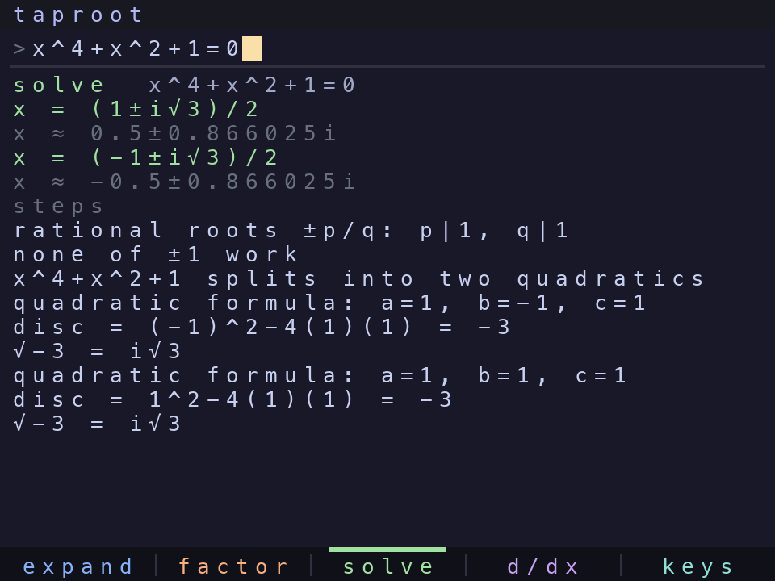
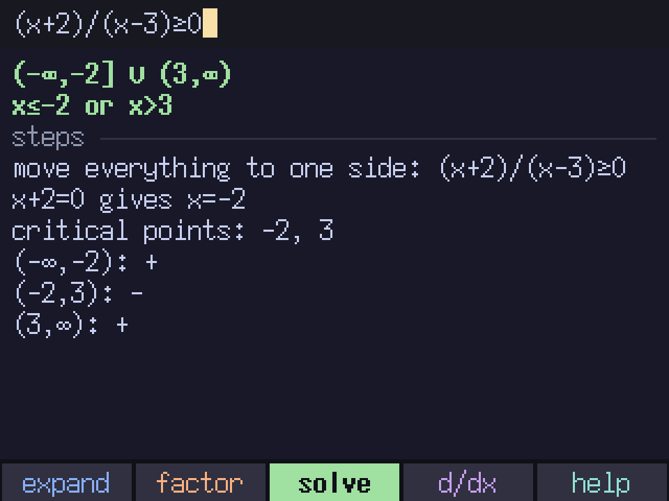
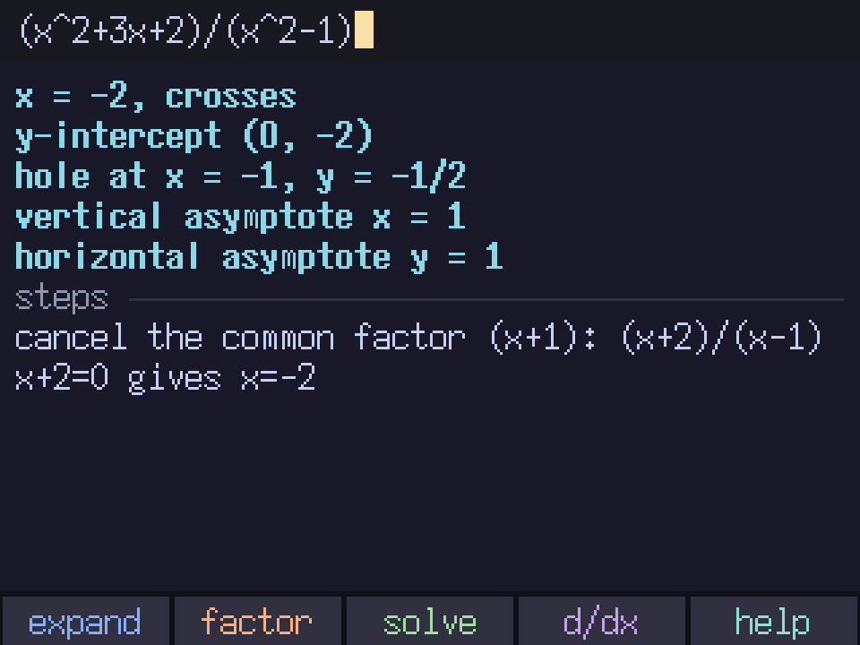
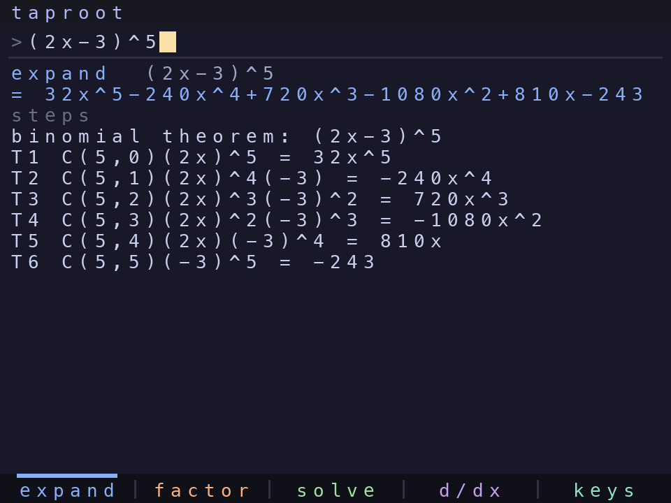
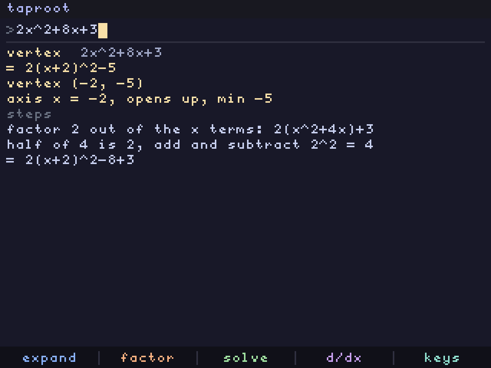
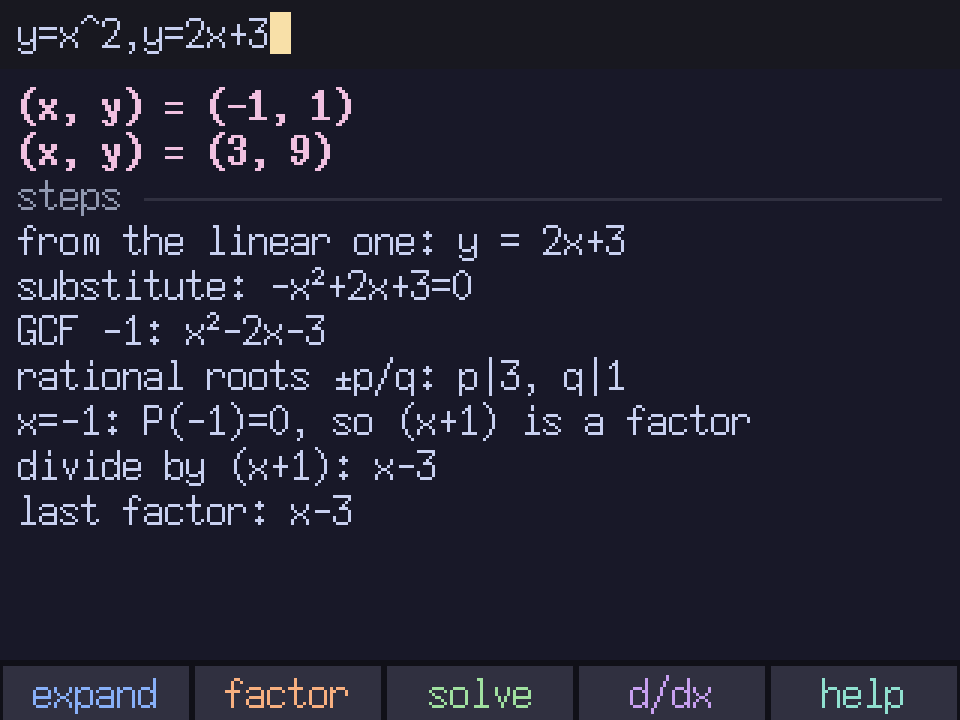

# taproot

**the algebra cas for the ti-84 plus ce that shows its work.**

type the problem, press one key. the exact answer comes first, every step sits right under it, and it all fits on the calculator you already carry to class.

## everything algebra 2 and precalc throw at you

| key | does | try |
|---|---|---|
| `y=` | **expand**, with the binomial theorem term by term | `(2x-3)^5` |
| `window` | **factor**: gcf, rational root test with synthetic division, quadratics that split, repeated factors | `2x^3-4x^2-22x+24` |
| `zoom` | **solve** equations exactly, radicals and `i` included | `2x^2+6x+3=0` |
| `zoom` | **inequalities** with a sign chart and interval notation | `(x+2)/(x-3)≥0` |
| `trace` | **d/dx** with the power and quotient rules | `3x^4-5x^2+7x-2` |
| `2nd y=` | **vertex form** by completing the square | `2x^2+8x+3` |
| `2nd window` | **zeros**: multiplicity, touch or cross, holes, asymptotes, end behavior | `(x^2+3x+2)/(x^2-1)` |
| `2nd zoom` | **systems**: 2x2 and 3x3 elimination, a line and a curve | `y=x^2, y=2x+3` |
| `2nd trace` | **inverse functions**, linear, quadratic and `(ax+b)/(cx+d)` | `(2x+1)/(x-3)` |

and the stuff in between:

- **rational expressions** simplify, add, subtract, multiply and divide, with the domain restrictions listed (`x ≠ -1, 1`).
- **rational equations** flag extraneous solutions instead of handing you a wrong one.
- **polynomial division** shows synthetic or long division and gives the quotient and remainder.
- **plug in or compose**: `x^3-2x+1, x=3` evaluates (and shows the remainder theorem), `x^2+1, x=2x-3` gives f(g(x)).
- **complex numbers**: `(2+i)/(1-3i)` divides by the conjugate and shows it.

## answers you can trust

taproot works in exact fractions, so `(-3±√3)/2` comes out as `(-3±√3)/2`, not 0.633974596. decimals only show up as a second line, or when no exact formula exists, and then it says so. its test suite checks it against a full computer algebra system (sympy) on thousands of random problems: factoring, solving, inequalities, rational equations, division, derivatives.

when a problem is too big or too sensitive to answer right, taproot tells you that instead of guessing. clear stops anything that's taking too long.

## how it compares

| | taproot | built-in os | pineapplecas | khicas |
|---|---|---|---|---|
| shows the steps | yes | no | no | no |
| exact factor and solve | yes | no, decimals only | no, it can't factor or solve | yes |
| type the problem right in the program | yes | n/a | no, it goes in Y1 first | yes |
| fits next to your other stuff | yes, ~83 kb | built in | yes | no, the install wipes your archive |

sources: [pineapplecas](https://github.com/nathanfarlow/PineappleCAS), [khicas for the 84](https://xcas.univ-grenoble-alpes.fr/backup/ti/khicas84.html), the [ti-84 plus ce guidebook](https://education.ti.com/html/webhelp/EG_TI84PlusCE/EN/content/home_84plusce_v5.7.HTML).

## it feels like a ti-84

- `X,T,θ,n` types x. `alpha` then a key types a letter, `2nd alpha` locks letters.
- `sto→` types `=`. `2nd math` types `=`, press it again for `<`, `>`, `≤`, `≥`.
- `2nd .` types `i`. `x²` types `^2`.
- `enter` solves when there's an `=` or an inequality, otherwise it repeats your last command.
- on an empty line, any command key runs on your last answer, so expand, then factor, then solve is three key presses.
- `2nd enter` brings back earlier inputs. `▲ ▼` scroll the steps.
- `graph` explains every key. `2nd mode` quits.

## install

1. get the ce c libraries ([clibs](https://github.com/CE-Programming/libraries/releases)) on your calculator, if they aren't there already.
2. send all three files from the release (`TAPROOT.8xp` and its two appvars) with ti connect ce or tilp.
3. on os 5.5 and newer, run it through [arTIfiCE](https://yvantt.github.io/arTIfiCE/).
4. taproot needs about 89 kb of free ram while it runs. archive your other programs if it says memory.

## build it yourself

with the [ce c toolchain](https://github.com/CE-Programming/toolchain) installed, `make` builds `bin/TAPROOT.8xp`. `make check` runs the test suite on your computer, and `test/random_check.py` checks it against sympy.

## license

[agpl-3.0](LICENSE). use it, share it, change it. if you ship a changed version, share your changes too.
